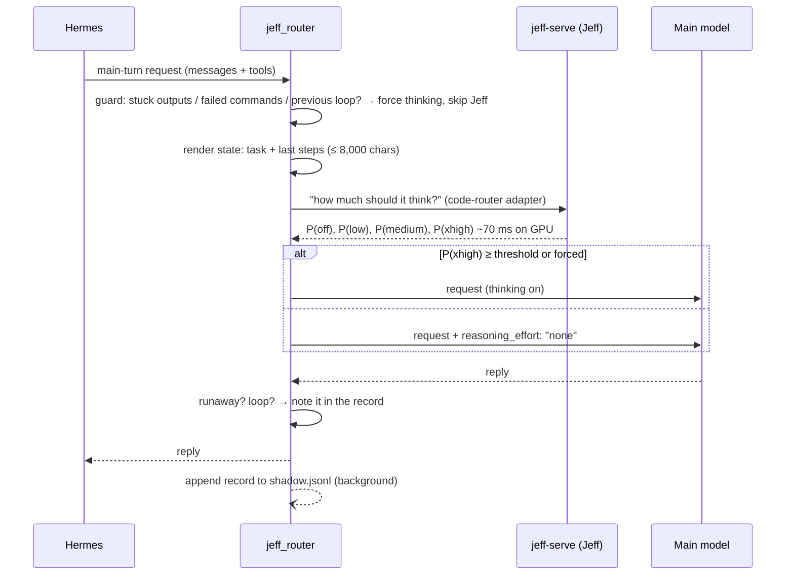

# How it works

`jeff_router` is a Hermes Agent plugin. It registers one `llm_execution` middleware, which wraps every main-turn
model call: the plugin sees the request before it goes out and the reply before Hermes uses it. Auxiliary calls
(compaction, titles, memory) pass through untouched.

It ports the thinking control from [Jeff-Code](https://github.com/firelex/jeff-code). There, Jeff (a 0.8B model with
LoRA adapters) decides how much the coding model should think. The large model stays in charge of every step. Jeff
only chooses whether that step gets thinking.

## Per call

### 1. Render the state

The plugin uses Jeff-Code's state format: the task (the first user message, followed by later user updates), then the most recent steps
rendered as shell commands with the last 40 lines of their output, within 8,000 characters. Hermes tools are mapped
to their shell equivalents (`read_file` → `cat` / `sed -n`, `search_files` → `grep -rn`, and so on), which is the
form the adapter was trained on.

### 2. Ask Jeff

Jeff gets the same question and the same four options as in Jeff-Code: `off`, `low`, `medium` and `xhigh`. The
plugin uses Jeff-Code's **jeff-off-unless** rule: thinking stays on only when `P(xhigh) ≥ router_threshold`. In every
other case the call goes out with `reasoning_effort: "none"`.

If Jeff fails, times out or is busy, the call thinks. The router can only ever remove thinking that Jeff is confident
isn't needed.

### 3. Guards (the safety net)

These are ported from Jeff-Code's `loop-guard.ts`, `runaway.ts` and `thinking-control.ts`:

| Guard | When | Effect |
|---|---|---|
| **Stuck outputs** | The last 3 tool results end the same way (Dice similarity ≥ 0.9 on the last 2,000 chars) | Think on this call |
| **Failed commands** | The last 2 terminal commands both failed | Think on this call |
| **Runaway** | The reply repeats a piece of text or a line many times (over 20,000 chars) | Log it in `guard` |
| **Loop** | Thinking was off and the reply repeats a recent tool call with nothing changed in between | Log it in `guard` |
| **Previous reply** | The last assistant reply in the history ran away, or repeated an earlier action with nothing changed | Think on this call |

Runaway and loop replies are not re-asked: Hermes makes `next_call` single-use per middleware, so the plugin can't
call the provider a second time. The reply is returned as is. The next calls think instead (the previous-reply guard),
until the latest reply is a new action. The check is made on the history each call, so no state is kept.

The guards run whenever `guards: true` (the default), whether or not Jeff is asked. With `main_thinking: false` that
gives guarded-off: no thinking unless a guard fires.

### 4. Log

After the reply, a background thread writes one JSONL record. The record holds the router decision, the guards, the
main model's cost (wall time, tokens, reasoning characters) and, with `tool_shadow: true`, the shadow comparison.
Writing it never delays the turn: records wait in a queue of up to 1,000, and if the disk falls that far behind, new
records are dropped with a one-time warning. On unload, queued records are still written. See [configuration.md](configuration.md#the-log).

## Shadow mode (v1)

Before the thinking router, v1 of this project ran Jeff in **shadow mode**. Jeff's `tools` adapter predicted which
tool the agent would call next, and the plugin logged that prediction beside what the main model actually did,
without changing anything. The shadow comparison is now off by default. Set `tool_shadow: true` to run it on every call and feed
`tools/shadow_report.py`.

The shadow data is the reason the project moved to thinking routing. On real Hermes traffic, predicting tools
offered little. Deciding whether to *think* was where the time and tokens went. See
[design/2026-10-31-v2-direction.md](design/2026-10-31-v2-direction.md).

## Code map

| File | Role |
|---|---|
| `plugin/jeff_router/__init__.py` | `register(ctx)`: reads the settings, wires the middleware, and stops it on unload |
| `plugin/jeff_router/middleware.py` | The per-call flow above |
| `plugin/jeff_router/thinking.py` | State rendering and the router question (port of `router-question.ts` / `pages.ts` / `state.ts`) |
| `plugin/jeff_router/guard.py` | Stuck-outputs, failed-commands, runaway and loop guards |
| `plugin/jeff_router/jeff_client.py` | HTTP client for jeff-serve, with timeouts and busy handling |
| `plugin/jeff_router/options.py`, `state.py`, `compare.py` | Shadow-mode tool options, state and match scoring |
| `plugin/jeff_router/shadow_log.py` | Owner-only, rotating, flock-guarded JSONL writer |
| `plugin/jeff_router/settings.py` | Defaults and validation |
| `tools/shadow_report.py` | Markdown report over the log |
| `probes/` | One-off scripts used during research: hook API, latency, end-to-end probe |
